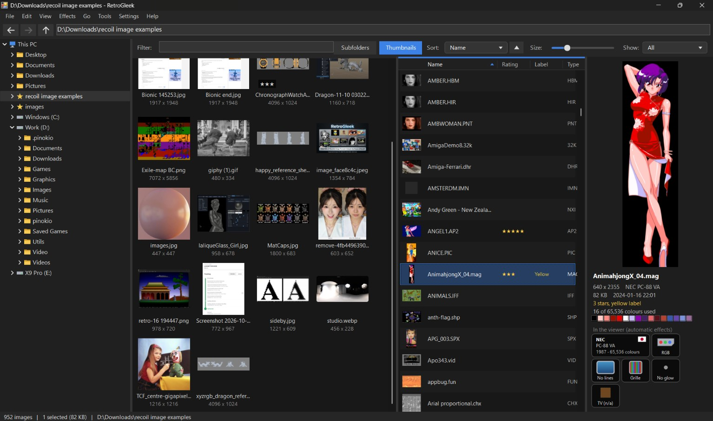
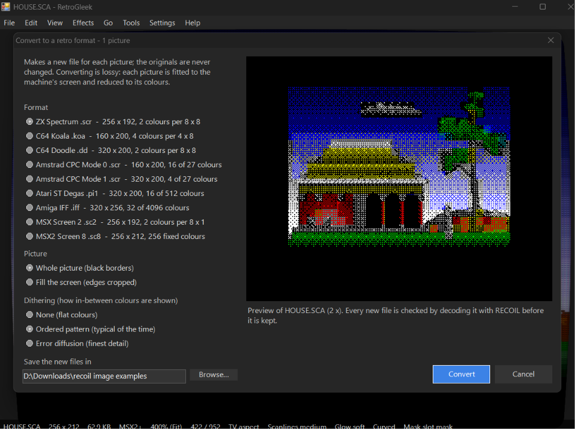

# RetroGleek

*Browse folders of modern and retro pictures* | *Sort, rate, tag and audit a collection*

### 📺 See your retro pictures the way they were meant to be seen

Modern screens make classic pixel art look cold, flat and sterile. RetroGleek brings back the warmth and depth
of the screens it was made for.

It doesn't just lay a filter over the picture: it recreates the path from the computer to your eyes, from the
cable the signal travelled down to the phosphors and the curved glass in front of them. Press **A** and every
picture gets the usual screen of its own computer:

* Scanlines and a soft phosphor glow
* Colours that blend as they did through S-Video and composite cables, so dithering melts into new shades
* Aperture grilles, slot masks and dot masks
* Gently curved glass with darker corners

It opens hundreds of retro formats out of the box (Amiga, Atari, Commodore 64, ZX Spectrum, MSX, Amstrad CPC
and many more, 567 file extensions in all) thanks to [RECOIL](https://github.com/pfusik/recoil).

### 🕹️ Your photos on an 8-bit computer

Press **Shift+O** on any photo to see it as a ZX Spectrum, C64, Amstrad CPC or MSX would have shown it, with
each machine's real colour limits, then save it as a file the real computer can load. Animated GIFs play too.

### 🖼️ More than a nostalgia machine

RetroGleek is also a fast, dependable viewer for everyday photos: JPEG, PNG, WebP, HEIC, AVIF, camera RAW and
more. It doesn't try to be a photo editor. It stays small, respects your privacy, and works 100% offline on
Windows 10 and 11.

It builds into **one small `.exe`** using the C# compiler that already ships with Windows: no SDK, no installer,
no NuGet packages and no internet connection.

## ⬇️ Download

**Windows 10 and 11.** Go to the [Releases](https://github.com/astroskiffle/RetroGleek/releases) page, download
`RetroGleek.exe`, put it in a folder of its own (it keeps its settings next to itself) and double-click it.
Nothing to install.

⚠️ RetroGleek isn't signed, so the first time Windows may say "Windows protected your PC": click **More info**, then
**Run anyway** ([why](GUIDE.md#antivirus-note)). Or [build it yourself](#build) from the source.

✅ To check your copy, open a Command Prompt in its folder and type `certutil -hashfile RetroGleek.exe SHA256`. The
result must match the SHA-256 listed on the release; if it doesn't, don't run the file.

## 🚀 Quick start

1. ⬇️ **Get it.** [Download](#download) `RetroGleek.exe`, or put all the source files in one folder and double-click
   **`build.bat`**, which makes `RetroGleek.exe` next to them in a few seconds (see [Build](#build)).
2. 📂 **Open a folder.** Start `RetroGleek.exe` and click a folder in the tree on the left, type a path in the address bar
   (**Ctrl+L**), or drag a folder onto the window.
3. 👀 **Look through it.** Arrow keys move, **Enter** or a double-click opens a picture, **Left / Right** step through
   the folder, **Esc** goes back. Type in the **Filter** box (**Ctrl+F**) to narrow the list; drag the **Size** slider
   for bigger thumbnails.
4. 📺 **Retro pictures.** Amiga, C64, ZX Spectrum, Atari and hundreds of other formats are listed with everything else
   (**F8** hides them). In the viewer, **A** gives each picture the screen of its own computer (scanlines, phosphor
   mask, TV signal), **O** turns the effects off and on, and **Shift+O** shows the picture with and without them side
   by side.
5. 🕹️ **A photo on an 8-bit computer.** Open any photo and press **Shift+O**: the right side shows it as it might look on
   a ZX Spectrum, C64, Amstrad CPC or MSX. **Q** changes the computer, **D** the dithering, **Shift+F** fills the
   screen, and **Ctrl+S** saves the computer's own file plus a PNG to share. Animated GIFs play too.
6. ⭐ **Keep the best.** **Alt+1** .. **Alt+5** rate a picture, **Shift+1** .. **Shift+5** give it a colour label, **X**
   tags it; the **Show** pull-down then lists only those.

Everything is in the **menu bar**, with its shortcut, and **F1** lists every key on one page. Nothing is ever
overwritten without asking, and RetroGleek never goes online.

## ✨ Features

- 🗂️ **Browse and organise:** folder tree and fast thumbnails, filter and sort, a details list, dual pane (two
  folders side by side), ratings, colour labels and tags, batch rename, undo, and a preview pane.
- 🔍 **View:** zoom, pan, slideshow, filmstrip, loupe, pixel grid, crisp or sharp enlargement, EXIF details, and
  animated GIFs and WebPs.
- 📺 **Retro:** 567 retro file extensions through RECOIL, screen effects (TV aspect, scanlines, phosphor mask,
  S-Video and composite signal, glow, curvature) chosen automatically per computer, clickable badges, and a retro
  preview that converts photos for the ZX Spectrum, C64, Amstrad CPC or MSX.
- 🧰 **Tools:** convert to retro formats, find duplicates and similar pictures, contact sheets, an offline HTML folder
  audit (also from the command line), Properties with every EXIF, IPTC and XMP detail, and lossless PNG export.
- 📷 **Modern formats:** JPEG, PNG, GIF, BMP and TIFF, plus WebP, AVIF, HEIC, JPEG XL and camera RAW through the
  decoders installed in Windows.

The [guide](GUIDE.md) describes every feature and key in detail.

## 🔒 Privacy and safety

- **Never goes online.** There is no network code at all: no telemetry, no update checks, no cloud.
- **Careful with your files.** Files are written only when you ask, nothing is ever overwritten without asking, and
  every change to a picture (a lossless turn, a rating or details written into it) is checked before it replaces the
  original. Cloud-only files are never downloaded.
- **Small footprint.** Settings live in `settings.ini` next to the program and your marks in `marks.tsv`; nothing goes
  in the registry.

More in the guide: [Privacy and security](GUIDE.md#privacy-and-security).

## 🛠️ Build

Put all the source files in one folder on Windows 10 or 11 and double-click **`build.bat`**. It uses the C#
compiler that comes with Windows and makes `RetroGleek.exe` in a few seconds, then shows its SHA-256 fingerprint.
Details in the [guide](GUIDE.md#build).

## ⚖️ License

RetroGleek is Copyright (c) 2026 Mark Billson and released under the [MIT License](LICENSE).

The bundled `RECOIL.cs` is a separate work by Piotr Fusik under its own MIT License; see
`THIRD-PARTY-NOTICES.txt`. Keep both notices when you redistribute RetroGleek.

## 🙏 Credits

Retro-computer picture decoding by **[RECOIL](https://github.com/pfusik/recoil)** by Piotr Fusik, used under the MIT
License. See `THIRD-PARTY-NOTICES.txt`.
